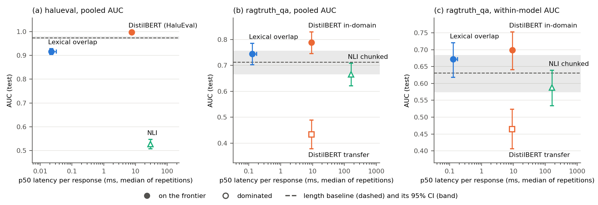

# HaluGate

**What do hallucination guardrails really detect?** A latency–accuracy benchmark of lexical,
DistilBERT and NLI detectors on HaluEval and RAGTruth QA, with an honest length baseline and
within-model evaluation.

**Author:** Marco Pérez Padilla · **Protocol fixed:** 11-10-2026
([`paper/protocol.md`](paper/protocol.md)) · **License:** MIT

## Table of contents

1. [Summary](#1-summary)
2. [Context and motivation](#2-context-and-motivation)
3. [Design decisions](#3-design-decisions)
4. [Architecture and classes](#4-architecture-and-classes)
5. [Tests](#5-tests)
6. [Development and challenges](#6-development-and-challenges)
7. [Setup](#7-setup)
8. [Running the pipeline](#8-running-the-pipeline)
9. [Scripts and results](#9-scripts-and-results)
10. [Discussion](#10-discussion)
11. [Limitations and conclusions](#11-limitations-and-conclusions)
12. [Reproducibility, license and references](#12-reproducibility-license-and-references)

---

## 1. Summary

A hallucination guardrail sits between an LLM and its user and decides, per response, whether
the answer is supported by the provided context. Guardrails are usually compared by accuracy on
a benchmark. This project asks two other questions: **how much of that accuracy is explained by
trivial shortcuts** (the length of the response, which model wrote it), and **what does each
detector cost in latency** for what it adds.

Six detectors and one reference are compared on two datasets under a protocol fixed *before*
any test result was seen:

| Detector | What it is |
|---|---|
| `lexical` | Unigram overlap between response and context |
| `distilbert` / `distilbert_indomain` | DistilBERT fine-tuned on HaluEval / on RAGTruth train |
| `distilbert_transfer` | The HaluEval model applied to RAGTruth with no further training |
| `nli` / `nli_chunked` | Zero-shot `cross-encoder/nli-deberta-v3-base`; the chunked variant windows long contexts |
| `length` | A **reference**, not a detector: it scores a response by its length |

Main findings (test split, AUC with 95 % bootstrap intervals; full tables in
[`results/tables/paper_tables.md`](results/tables/paper_tables.md)):

- **HaluEval is almost solved by response length.** `length` alone reaches AUC 0.974;
  DistilBERT reaches 0.997 (+0.023 [+0.018, +0.028]); lexical overlap (0.917) is below the
  length baseline.
- **Zero-shot NLI does not work on HaluEval** (AUC 0.527, recall 1.00, precision 0.50: it flags
  everything).
- **On RAGTruth only the in-domain DistilBERT beats `length`**, and only modestly: +0.076
  [+0.036, +0.115] pooled and +0.068 [+0.017, +0.119] within generating model. Lexical overlap
  and `nli_chunked` are statistically indistinguishable from `length`.
- **Transfer fails.** The HaluEval model scores 0.434 [0.378, 0.489] pooled (below chance) and
  is at chance within model (0.464 [0.406, 0.523]).
- **The latency frontier** on RAGTruth holds lexical overlap (≈ 0.13 ms) and in-domain
  DistilBERT (≈ 9 ms); `nli_chunked` (≈ 164 ms, p95 609 ms) is dominated.

These conclusions apply to these detectors, these two datasets and these settings; they say
nothing general about hallucination detectors (see [Limitations](#11-limitations-and-conclusions)).



## 2. Context and motivation

### 2.1 The task

Given a *context* (retrieved passages or a knowledge snippet) and a *response* written by an
LLM, label the response as hallucinated (not supported by the context) or grounded.

### 2.2 Datasets

- **HaluEval QA.** Synthetic: each record has a right answer and a hallucinated answer written
  to look plausible. Both answers share the same context, so a record yields one negative and
  one positive sample (10,000 records, 20,000 samples). Responses are mostly short answer
  spans.
- **RAGTruth, QA task.** Organic: 989 questions with passages and 5,934 full-sentence
  responses, six per source (one per generating model), annotated by humans. The official
  partition is used: train 5,034 responses (31.1 % positive), test 900 responses from 150
  sources (17.8 % positive, 160 positives). Four generating models have enough positives in
  test (≥ 20) to be analysed one by one: Llama-2-7b-chat (52 positives), Llama-2-13b-chat (36),
  Llama-2-70b-chat (35) and Mistral-7B-instruct (31). The two OpenAI models have 5 and 1
  positives; they enter the pooled and the within-model figures but are not interpreted
  separately.

HaluEval is the primary, easier dataset; RAGTruth checks whether what holds on synthetic
hallucinations survives organic ones.

### 2.3 Why not just report accuracy

Two shortcuts can inflate any benchmark number:

1. **Response length.** If hallucinated and grounded responses differ in length, a detector can
   score well without reading the context. `length` makes this explicit and is reported next
   to every detector.
2. **Generating model.** In RAGTruth each model hallucinates at a different rate and writes
   differently. A detector that identifies *which model wrote the text* looks accurate pooled
   but not within model. Hence the **within-model AUC**.

## 3. Design decisions

### 3.1 Protocol written before the results

[`paper/protocol.md`](paper/protocol.md) fixes, before the first RAGTruth test run: the inputs,
the detectors and their hyperparameters, the metrics, the frontier rule, what is **not**
allowed after seeing test results (changing the NLI model, window size, aggregation or
thresholds; swapping a primary result for a variant), and the limitations. Every change
afterwards is a **dated amendment** (14-10, 17-10 and 21-10-2026); the original text is never
edited. All arms are reported whatever their result.

### 3.2 Metrics

- **Primary: AUC-ROC** with a 95 % percentile bootstrap (1,000 resamples, seed 42) that
  resamples **whole sources**, never single responses of the same source. AUC is primary
  because the positive rate differs between train (31 %) and test (18 %), which moves F1,
  precision and recall at a validation-calibrated threshold for every detector.
- **Secondary:** precision, recall and F1 of the positive class at a threshold calibrated on
  validation. Accuracy is not reported.
- **Within-model AUC:** only pairs of responses written by the same generating model are
  compared, and each model counts in proportion to its number of (positive, negative) pairs, so
  a model with a handful of positives barely moves the result. In the per-model table, models
  with fewer than 20 positives are flagged as not interpretable.
- **Difference with `length`:** a *paired* grouped bootstrap, since both AUCs are computed on
  the same resamples. A detector "beats length" only if the lower bound of the difference is
  above 0.

### 3.3 The latency–accuracy frontier

Detector A **dominates** B if A's p50 latency is ≤ B's and A's AUC interval lies entirely above
B's. A detector is on the frontier if nobody dominates it. `length` is a reference outside the
rule. Latency is timed one response at a time after 3 warm-ups on the first 200 test
responses, **repeated 5 times**; the frontier uses the median of the repeated p50 and the
tables show the range, because some detectors (notably `nli_chunked`) are not stable between
runs.

### 3.4 The chunked NLI detector

Long contexts do not fit in a cross-encoder window. `nli_chunked` splits the response into
sentences and the passages into windows of ≤ 350 tokens; a sentence's support is the maximum
entailment probability over windows, and the response score is the maximum over sentences of
`1 − support`. It was fixed in the protocol (a single configuration) and could not be tuned
after seeing results.

### 3.5 Truncation rule

DistilBERT sees at most 512 tokens. The passages are truncated, never the response (fallback
to `longest_first` only if the response alone exceeds the limit). `scripts/truncation_report.py`
measures how many test pairs are affected: on RAGTruth test, **31.6 %** of pairs are truncated
(42.5 % of positives vs 29.2 % of negatives, so truncation is not independent of the label); on
HaluEval, 0 %. This penalises DistilBERT and not NLI, and is declared as a limitation.

### 3.6 Reproducibility

- Docker image pinned by digest; `requirements-lock.txt` from `pip freeze`.
- Hugging Face model revisions pinned in `configs/config.yaml`.
- `results/manifest.json`: git commit, dirty state, SHA-256 of config, protocol, data and model
  weights, installed versions.
- fp16 training is not bit-reproducible, so **trained weights are artefacts**, not reproducible
  from the seed alone.

## 4. Architecture and classes

```
configs/config.yaml        datasets, strategies, params, seeds, split ratios
src/
├── data_loading.py        HallucinationSample, DatasetLoader (HaluEval, RAGTruth), cache
├── splitting.py           group-aware 70/15/15 split; official test partition for RAGTruth
├── strategies/            one file per detector
│   ├── base.py            HallucinationDetector (ABC)
│   ├── lexical_overlap.py
│   ├── distilbert_classifier.py
│   ├── nli_detector.py / nli_chunked.py
│   └── response_length.py
├── factory.py             get_detector(name, params)
├── evaluate.py            pipeline: scores, calibration, metrics, checkpointing
├── statistics.py          bootstrap AUC, paired differences, stratified AUC, dominance
├── reporting.py           frontier table, uncertainty columns, per-group rows
├── latency_bench.py       per-sample latency; latency_repeats.py repeats it 5×
├── truncation.py          fraction of truncated pairs
├── manifest.py            reproducibility manifest
├── paper_tables.py        paper_figures.py   tables and figures from the CSVs
└── errors.py              HaluGateError hierarchy
scripts/                   one CLI per step (see section 9)
tests/                     pytest suite
paper/protocol.md          fixed protocol and amendments
```

**Key design points**

- **`HallucinationDetector`** is an abstract base class: subclasses implement only
  `predict_batch(contexts, responses) -> (labels, scores)`; `predict()` and `score()` are
  derived. Scores are continuous in [0, 1] (higher = more likely hallucinated) so every
  detector can be evaluated with AUC.
- **Factory + config**: adding a dataset or a strategy is a config change (plus one file and
  one factory entry for a genuinely new detector); `evaluate.py` is not edited.
- **Group-aware splits**: samples sharing a context (or a RAGTruth source) never straddle
  train/validation/test, so a response and its answer pair cannot leak.
- **`HallucinationSample`** is an immutable dataclass carrying the context, the response, the
  label, a group id, the official split and the generating model.
- **Dataset loaders** share a caching layer: subclasses only parse their raw format, and the
  processed samples are cached as JSON Lines so an interrupted run does not re-parse the raw
  files.
- **Checkpointing** in `evaluate.py` writes partial scores every 500 samples so an interrupted
  run does not restart.
- Analysis code (`statistics`, `reporting`, `paper_*`) is **pure over the CSV results**: it
  never runs a model, so tables and figures cannot disagree with the numbers they come from.

## 5. Tests

The suite (`pytest`, **462 tests**) covers every module in `src/`:

| Area | Tests |
|---|---|
| Data and splits | `test_data_loading`, `test_splitting`, `test_training_data` |
| Detectors and factory | `tests/strategies/`, `test_factory`, `test_text_chunking`, `test_tokenization` |
| Evaluation | `test_evaluate`, `test_calibration`, `test_breakdown` |
| Statistics and reporting | `test_statistics`, `test_reporting`, `test_errors` |
| Latency and truncation | `test_latency_bench`, `test_latency_repeats`, `test_truncation` |
| Reproducibility | `test_manifest` |
| Paper outputs | `test_paper_tables`, `test_paper_figures` |

Principles followed:

- **Test what the output promises**, not how it is computed (e.g. a figure test checks that
  frontier detectors are filled markers and dominated ones hollow, not pixel values).
- **Fakes instead of models** in unit tests, so the suite runs without GPU or downloads.
- **Mutation checks** on the newest modules: deliberately breaking the code (wrong ordering,
  wrong comparison, off-by-one) and confirming a test fails; surviving mutants became new tests.

```bash
docker compose exec halugate pytest        # or: pytest
```

## 6. Development and challenges

The project was built in phases; each one ended with results checked before the next one
started. The table lists the problems that changed the design or the numbers, not every bug.

| Problem | Cause | What was done |
|---|---|---|
| HaluEval accuracy looked excellent for every trained model | Hallucinated answers are systematically different in length from right ones | Added `length` as a **reference** detector, reported next to every result, and a paired bootstrap of "detector − length" |
| Pooled RAGTruth AUC can reward identifying the author model | Each generating model hallucinates at a different rate | Added the within-model (stratified) AUC and a per-model breakdown |
| Zero-shot NLI scored AUC ≈ 0.5 on HaluEval | Adding the question to the context was tried and measured: it did not help and let answers that restate the question look supported | Context is the passage only, the same rule on both datasets (see the `HaluEvalLoader` docstring) |
| NLI cannot read long RAGTruth contexts in one window | 512-token limit | `nli_chunked`: sentence-level scoring against ≤ 350-token windows; one configuration fixed in the protocol before any result. A first smoke test (`scripts/nli_contact.py`) checked the plumbing only |
| Suspicion that `nli_chunked` was just tracking response length | Both vary with response size | Dropped once the paired difference with `length` was measured: −0.047 [−0.109, +0.019] |
| DistilBERT loses evidence on long RAGTruth inputs | Passages are truncated to 512 tokens | Fixed truncation rule (never truncate the response) and a report of how many pairs are affected: 31.6 % on RAGTruth test, 0 % on HaluEval |
| Single-run latency was unstable for some detectors | GPU clocks, caching, other processes | `latency_repeats.py`: 5 repetitions, 3 warm-ups, p50 reported as a range; the frontier uses the median; a random sample is run as a sensitivity check (e.g. `nli_chunked` is 23 % faster on it) |
| Latency numbers could silently depend on the machine | Hardware and library versions differ | Each latency run writes `latency_environment_<run>.json` |
| 5 tests failed after adding revision pinning | The detector attribute was `_revision` in one copy and `revision` in the test | Unified the attribute name |
| Manifest reported 3 packages differing from the lock | `pip`, `setuptools`, `wheel` appeared twice (system and upgraded); the last one found won | Keep the first distribution found; regression test added |
| Two strategies sharing one model with different pinned revisions overwrote each other in the manifest | `build_manifest` kept a single revision per model | Keep a list of revisions and warn when none is pinned, they differ, or one is not in the cache |
| Figure labels crossed error bars | Labels were placed beside the points | Labels above the interval (below for one detector), and the baseline explained in the legend instead of in the panels |

**Known issues, left as they are:**

- The Docker build context is large (5.4 GB) because there is no `.dockerignore`; adding one
  (`data/`, `results/`, `models/`, `.git`, caches) is a one-file change.
- `results/manifest.json` was generated on a working tree with uncommitted changes
  (`dirty: true`); the code state is therefore not exactly a commit.
- The base model `distilbert-base-uncased` is downloaded without a pinned revision.
- Per-sample scores are not kept as files; tables are regenerated by re-running
  `src/evaluate.py` (GPU recommended).

## 7. Setup

### 7.1 Requirements

- A CUDA GPU is recommended: DistilBERT training and the NLI detector are slow on CPU. The
  reported numbers were measured on an NVIDIA RTX 5060 Laptop GPU under Docker on WSL2
  (Python 3.10.12, torch 2.11.0+cu128, transformers 5.18.0, numpy 1.26.4).
- Roughly 5 GB of disk for the image and cache, plus the datasets and the two trained models.

### 7.2 With Docker

```bash
git clone https://github.com/marco-prezpad/HaluGate.git
cd HaluGate
docker compose up -d halugate        # builds the image (base image pinned by digest)
docker compose exec halugate pytest  # 462 tests should pass
```

The compose file mounts `data/`, `results/` and `models/` from the host, so downloads, trained
models and results persist outside the container. Every command below is
`docker compose exec halugate <command>`.

### 7.3 Without Docker

```bash
python3.10 -m venv .venv && source .venv/bin/activate
pip install --extra-index-url https://download.pytorch.org/whl/cu128 -r requirements-lock.txt
pip install --no-deps -e .
pytest
```

Run the commands below directly, without the `docker compose exec halugate` prefix. On CPU
only, install the matching torch build instead of the `cu128` one.

### 7.4 Data

Raw files go under `data/` (not tracked). Both datasets are MIT-licensed upstream.

**PowerShell** (from the project folder):

```powershell
New-Item -ItemType Directory -Force -Path data\raw\ragtruth
curl.exe -L -o data\raw\halueval_qa.jsonl https://raw.githubusercontent.com/RUCAIBox/HaluEval/main/data/qa_data.json
curl.exe -L -o data\raw\ragtruth\response.jsonl https://raw.githubusercontent.com/ParticleMedia/RAGTruth/main/dataset/response.jsonl
curl.exe -L -o data\raw\ragtruth\source_info.jsonl https://raw.githubusercontent.com/ParticleMedia/RAGTruth/main/dataset/source_info.jsonl
```

**Bash:**

```bash
mkdir -p data/raw/ragtruth
curl -L -o data/raw/halueval_qa.jsonl https://raw.githubusercontent.com/RUCAIBox/HaluEval/main/data/qa_data.json
curl -L -o data/raw/ragtruth/response.jsonl https://raw.githubusercontent.com/ParticleMedia/RAGTruth/main/dataset/response.jsonl
curl -L -o data/raw/ragtruth/source_info.jsonl https://raw.githubusercontent.com/ParticleMedia/RAGTruth/main/dataset/source_info.jsonl
```

Resulting layout:

```
data/raw/halueval_qa.jsonl           one JSON per line: question, knowledge, right_answer, hallucinated_answer
data/raw/ragtruth/response.jsonl     official RAGTruth responses (with labels and split)
data/raw/ragtruth/source_info.jsonl  official RAGTruth sources (QA passages)
```

(The HaluEval file is named `qa_data.json` upstream but is JSON Lines; it is saved here as
`.jsonl`.) Processed samples are cached in `data/processed/` the first time they are read.

## 8. Running the pipeline

The order matters: protocol decisions and trained models come before the evaluation, and the
manifest is written last, after every run it describes.

```bash
# 0. Inspect the RAGTruth files (reads files only; no detector is run)
python scripts/inspect_ragtruth.py --data-dir data/raw/ragtruth

# 1. Train the two DistilBERT models (resumable: re-running resumes from the last checkpoint)
python scripts/train_distilbert.py --config configs/config.yaml \
    --dataset halueval --output-dir models/distilbert-halu
python scripts/train_distilbert.py --config configs/config.yaml \
    --dataset ragtruth_qa --output-dir models/distilbert-ragtruth

# 2. Evaluate every detector on every dataset (checkpointed every 500 samples)
python -m src.evaluate --config configs/config.yaml

# 3. Repeated latency measurements (protocol sample) and a random-sample sensitivity run
python scripts/latency_repeats.py --sample first
python scripts/latency_repeats.py --sample random --datasets ragtruth_qa

# 4. Share of truncated pairs
python scripts/truncation_report.py

# 5. Reproducibility manifest (exit code 1 under --strict if anything is not pinned)
python scripts/write_manifest.py --strict

# 6. Paper tables and figures from the CSV files above (no model runs)
python scripts/make_paper_outputs.py
```

Exploratory scripts used while designing the protocol (they do not feed the final tables):
`scripts/nli_contact.py` (first smoke test of the chunked NLI), `scripts/analyze.py` (lexical
overlap on the RAGTruth train partition) and `scripts/length.py` (the length baseline).

## 9. Scripts and results

| Command | What it does | Writes |
|---|---|---|
| `scripts/inspect_ragtruth.py` | Reads the raw RAGTruth files and prints counts per split and flag | stdout |
| `scripts/train_distilbert.py` | Fine-tunes DistilBERT on the train split of a dataset (3 epochs, lr 2e-5, batch 16, seed 42; best checkpoint by validation loss) | `models/<name>/` |
| `src/evaluate.py` | Scores every (dataset, detector), calibrates thresholds on validation, computes metrics, bootstrap intervals, paired differences with `length`, per-model AUC | `results/tables/metrics_summary.csv`, `auc_by_model.csv`, `frontier.csv`, `results/latency/*.parquet`, `results/logs/evaluate.log` |
| `scripts/latency_repeats.py` | Repeats the per-sample latency timing | `results/tables/latency_repeats.csv`, `latency_summary.csv`, `latency_environment_<run>.json`, `results/latency/repeats_raw_<run>.parquet` |
| `scripts/truncation_report.py` | Counts pairs that exceed the DistilBERT limit | `results/tables/truncation.csv` |
| `scripts/write_manifest.py` | Hashes config, protocol, data and weights; records commit, versions and Hub revisions | `results/manifest.json` |
| `scripts/make_paper_outputs.py` | Builds the paper tables, recomputes the frontier with the median repeated p50 and draws the figures | `results/tables/paper_*.csv`, `paper_tables.md`, `results/figures/{frontier,vs_length,per_model}.{png,pdf}` |

`results/figures/` holds three figures: **frontier** (latency vs AUC, pooled and within-model),
**vs_length** (AUC minus the length baseline with paired intervals) and **per_model** (AUC per
generating model).

### Main result, RAGTruth QA (test)

| Detector | AUC [95 % CI] | Within-model AUC | AUC − length | p50 (ms) | Frontier |
|---|---|---|---|---|---|
| Lexical overlap | 0.745 [0.702, 0.785] | 0.672 | +0.032 [−0.027, +0.090] | 0.129 | on |
| DistilBERT transfer | 0.434 [0.378, 0.489] | 0.464 | −0.278 [−0.364, −0.190] | 9.2 | dominated |
| DistilBERT in-domain | 0.788 [0.746, 0.829] | 0.699 | +0.076 [+0.036, +0.115] | 9.28 | on |
| NLI chunked | 0.666 [0.622, 0.708] | 0.588 | −0.047 [−0.109, +0.019] | 164 | dominated |
| Length (reference) | 0.712 [0.665, 0.756] | 0.631 | – | 0.0072 | reference |

### Main result, HaluEval QA (test)

| Detector | AUC [95 % CI] | AUC − length | p50 (ms) | Frontier |
|---|---|---|---|---|
| Lexical overlap | 0.917 [0.904, 0.929] | −0.057 [−0.072, −0.043] | 0.0225 | on |
| DistilBERT | 0.997 [0.994, 0.999] | +0.023 [+0.018, +0.028] | 7.61 | on |
| NLI | 0.527 [0.507, 0.547] | −0.447 [−0.469, −0.426] | 29.6 | dominated |
| Length (reference) | 0.974 [0.968, 0.979] | – | 0.0013 | reference |

The remaining tables (latency, truncation, precision/recall/F1) are in
`results/tables/paper_tables.md`.

## 10. Discussion

**What the results support**

1. **Benchmark accuracy overstates what detectors do.** On HaluEval a counter of tokens
   reaches AUC 0.974, and the best detector (trained DistilBERT, 0.997) adds 0.023. Reading
   the context is not needed to score well there.
2. **Zero-shot NLI is not a shortcut to a guardrail.** On HaluEval it flags everything (recall
   1.00, precision 0.50). On RAGTruth, with windowing, it is not distinguishable from `length`
   and costs about 164 ms per response (p95 609 ms): it ends up dominated.
3. **A detector trained on one benchmark does not transfer.** The HaluEval DistilBERT scores
   below chance on RAGTruth pooled and at chance within model. The pooled inversion is partly
   an author-model effect: the within-model AUC is the more honest number.
4. **Training in the target domain gives a small, real edge over `length`** (+0.068
   [+0.017, +0.119] within model), but it is heterogeneous across generators (see the
   `per_model` figure). Its point estimate is above `length` on the three Llama models and not
   on Mistral, where `length` is as good (0.763 vs 0.751). The per-model plot is descriptive:
   with 31–52 positives per model the intervals are wide.
5. **Cheap is not necessarily worse.** Lexical overlap, about 70× faster than DistilBERT, is
   indistinguishable from `length`, and its within-model AUC (0.672) is close to the in-domain
   DistilBERT's (0.699), although that direct comparison was not tested. It stays on the
   frontier.

**What the results do not support**

- That in-domain DistilBERT beats lexical overlap: the pooled difference exists on paper
  (0.788 vs 0.745) but the paired within-model difference between them was not computed.
- A cause for the in-domain edge. It may be content, style, or an author-specific shortcut; no
  ablation was run.
- Any statement about hallucination detectors in general.

**Operating point.** At the calibrated threshold, in-domain DistilBERT has precision 0.32 and
recall 0.76 (F1 0.45) on RAGTruth: about two of every three alerts are false, and `length`
alone gets F1 0.41. A deployed guardrail would need a use case that tolerates that.

## 11. Limitations and conclusions

### Limitations

- **Two datasets, QA only**, one language, and a single detector per family.
- **Small test set on RAGTruth**: 900 responses from 150 sources, 160 positives; within-model
  intervals are wide, and only four generating models can be examined separately.
- **Truncation affects DistilBERT, not NLI**: 31.6 % of RAGTruth test pairs, and 42.5 % of the
  positives against 29.2 % of the negatives, so truncation is not independent of the label.
  This asymmetry is declared in the protocol; its effect on the AUC was not measured.
- **Latency was measured on one machine** (laptop GPU, WSL2) and one response at a time; it
  does not describe batched or server throughput.
- **Trained weights are artefacts**: fp16 training is not bit-reproducible, and the base model
  is not pinned to a revision.
- The reproducibility gaps listed under *Known issues* (section 6).

### Conclusions

Under a protocol fixed in advance, with a length baseline and within-model intervals, the cheap
guardrails here are much less impressive than their benchmark accuracy suggests: only a
classifier trained in the target domain clearly beats response length, and by a small margin
that does not hold for every generating model. The contribution is the evaluation design, a
reusable pipeline, and a set of honest baselines: they show how much of a guardrail's accuracy
is explained by shortcuts before any claim about *detecting* hallucinations is made.

## 12. Reproducibility, license and references

- **Pinned:** Docker base image by digest, `requirements-lock.txt`, Hub revision of the NLI
  model, random seed 42, split ratios and all hyperparameters in `configs/config.yaml`.
- **Recorded:** `results/manifest.json` (commit, dirty state, SHA-256 of config, protocol, data
  and weights, installed versions).
- **Not tracked in git:** `data/`, `models/`. Retrain with section 8 and compare the weight
  hashes with the manifest.
- **Datasets:** HaluEval (Li et al., EMNLP 2023) and RAGTruth (Niu et al., ACL 2024), both
  MIT-licensed upstream. They are not redistributed here: download them as in section 7.4.
- **Code license:** MIT, see [`LICENSE`](LICENSE).
- **Protocol:** [`paper/protocol.md`](paper/protocol.md) with its dated amendments.